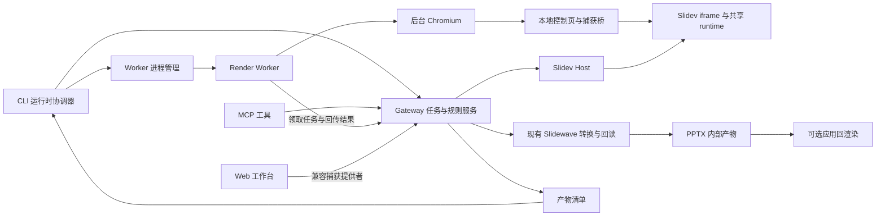

# FastPPT CLI 无窗口预览与导出更新规划

日期：2026-10-23。状态：规划，尚未实施。代码核查基线：`9bd5cd65` 及当前工作树；工作树包含进行中的原生表格、快照版本协商等变更，实施时须基于届时实际代码复核。

目标是让用户通过 CLI 完成生成后的检查、预览、修订和可编辑 PPTX 导出，无需手动启动服务或打开 FastPPT 网页。CLI 自动管理本地运行环境，用后台浏览器完成 Slidev 渲染，将预览图、检查报告和导出文件交付到本地。交互式 Web 工作台继续作为可选入口。

本文中的新增命令、参数、接口和目录均为目标设计。既有命令的当前行为以实际 CLI 帮助为准。

## 1. 产品目标与交付边界

### 1.1 用户可感知的结果

1. 关闭所有浏览器窗口，在一个已有 `slides.md` 的工作区执行命令，可以得到逐页预览、缩略图和可编辑 PPTX。
2. 不必先执行 `fastppt start`、`preview start`，也不必保持第二个终端运行服务。
3. 长任务显示当前阶段、已完成页数、耗时和可定位的错误，不因缺少 Web 客户端一直等待捕获。
4. 普通终端得到图片与文件路径；支持图片的宿主可以直接展示这些产物。非图片终端不会被迫打开浏览器。
5. CI 和 SSH 环境通过同样的命令产出结果，并可使用结构化输出、明确退出码和超时控制。
6. 需要交互演示时，用户仍可主动打开 Web 预览。

### 1.2 必须分清的三种证据

| 产物 | 回答的问题 | 可以证明的范围 |
| --- | --- | --- |
| Slidev 逐页截图与缩略图 | 源稿在渲染引擎中是什么样子 | HTML/CSS 的实际呈现、内容布局和源稿侧溢出 |
| PPTX 结构回读与质量报告 | 导出文件包含什么对象 | 文字、表格、形状、字体声明、页序和规则符合情况 |
| 实际 PPTX 的应用回渲染 | 导出的文件在某个应用中是什么样子 | 指定应用、版本、字体和环境下的静态呈现 |

网页截图不能作为 PPTX 应用渲染证据；XML 回读不能证明视觉一致；应用截图不能证明对象可编辑。报告分别记录三种状态，应用编辑仍需相应验收。

### 1.3 首版和后续范围

| 范围 | 内容 |
| --- | --- |
| 首版必须 | 后台捕获、自动服务生命周期、PNG 预览与缩略图、现有溢出/质量检查、可编辑 PPTX 导出、文件交付、取消与清理、打包后真实端到端验证 |
| 首版兼容 | 现有 CLI 命令、MCP 工具、Web 捕获、主题规则、母版/占位符、快照版本协商、导出审核与重试语义 |
| 后续增强 | 持续预览、终端图片适配、会话等待、实际 PPTX 回渲染及差异报告、可选 PDF 输出 |
| 本项目不承担 | 重写 Slidev、创建另一套 PPTX 转换器、扩大原生表格/图表/公式支持范围、交互式 TUI 编辑器、全量动画与视频导出 |

“无需独立浏览器”指无需用户启动或操作浏览器窗口。后台仍使用浏览器引擎执行 Vue、布局、字体度量及页面捕获。

## 2. 当前代码与缺口

| 模块 | 已有能力 | 本次缺口 |
| --- | --- | --- |
| `apps/cli/src/arguments.ts`、`cli.ts` | Gateway 启停、状态与诊断；默认不打开网页 | 核心命令没有自动准备及释放运行环境的统一入口 |
| `apps/cli/src/core-arguments.ts`、`core.ts` | 核心工具映射；通过 MCP 内存传输复用服务 | 没有截图命令；渲染操作依赖已启动 Gateway；普通模式也输出 JSON |
| `packages/fastppt-mcp/src/gateway-delegate.ts` | 创建检查/导出任务、轮询状态、下载 PPTX 到内部目录 | 依赖外部捕获者；CLI 超时未形成贯穿 HTTP、轮询、捕获和下载的统一截止时间 |
| `apps/gateway/src/app.ts` | 预览代理、导出/检查接口、任务事件、规则校验 | 捕获请求广播给浏览器；没有统一执行者领取与租约控制 |
| `apps/gateway/src/export-jobs.ts` | 等待快照、转换、回读、审核、恢复与重试 | 没有后台捕获提供者；等待审核的产物尚不能由 CLI 完整预览和处理 |
| `apps/gateway/src/browser-delegation.ts` | 单页检查任务、超时、结果接收 | 缺少跨执行者的领取、取消、失败分类和过期提交防护 |
| `apps/web/src/components/workspace/PreviewPanel.vue` | iframe ready、版本协商、捕获请求和结果回传 | 浏览器捕获编排集中在 Vue 组件，后台无法直接复用 |
| `packages/slidewave/src/browser` | 页面捕获、溢出/质量检查、消息协议 | 需提炼宿主无关的控制桥；截图需绑定稳定渲染状态 |
| `packages/slidev-host` | 启动和管理 Slidev，注入捕获 runtime | 需提供实例身份、稳定就绪和租用/释放信息 |
| `apps/cli/scripts/build.mjs` | 打包 CLI、MCP、Slidewave、主题和运行资源 | 缺少 Worker、控制页和浏览器依赖的分发验证 |

当前 `scripts/browser-boundaries.test.mjs` 明确禁止 Gateway、MCP、Slidewave server 和指定主题 Skill 直接引入浏览器启动器。本次维持这条职责边界，让独立 Worker 持有浏览器。

已有导出接口会按需要启动 Slidev；本项目应复用该能力，不再增加第二套预览启动路径。已有导出审核默认关闭，本项目也不统一增加人工批准步骤；仅在显式启用审核或现有策略要求时保持该状态。

## 3. 默认决策

| 事项 | 规划决定 |
| --- | --- |
| 后台渲染所有者 | 新增 `packages/render-worker`，独立 Node 进程持有 Chromium |
| 浏览器驱动 | 采用 Playwright 驱动适配层；生产依赖单独声明，版本在实施时与项目兼容性验证后锁定，不依赖测试包的间接安装 |
| 普通渲染命令 | 默认采用 headless，自动准备环境；不因存在 Web 页面而改变结果来源 |
| Gateway | 复用兼容、健康、同一工作区的实例；无实例时创建受租约管理的临时实例 |
| 捕获与转换 | Web 和 Worker 使用同一捕获协议；继续使用唯一的 snapshot → Slidewave server → PPTX 路径 |
| 首版并发 | 每工作区一个 Worker，渲染队列默认串行；各任务隔离 BrowserContext，后续按实测扩展 |
| 预览格式 | 首版 PNG 加缩略图及 manifest；PDF 为后续明确类型的输出 |
| 文件覆盖 | `--output` 指定路径；存在时失败，只有显式 `--overwrite` 才替换 |
| 输出兼容 | 现有命令默认 JSON 在兼容期保留；新增命令提供可读摘要；`--json` 保持机器可用 |
| 实际 PPTX 预览 | 可选适配器，首个实现以 LibreOffice 回渲染为候选；缺依赖时明确不可用 |

## 4. 用户流程和 CLI 契约

以下命令均展示目标状态，不表示当前版本已支持。

### 4.1 核心用法

```bash
# 一次性安装受管理的浏览器引擎，之后不需要打开浏览器
fastppt render install
fastppt doctor --scope render

# 整套 PNG、缩略图和产物清单
fastppt preview render --path slides.md --output ./preview

# 只查看指定页或页范围
fastppt preview render --path slides.md --slide 3 --output ./preview-page-3
fastppt preview render --path slides.md --slides 1,3-5 --output ./preview-selected

# 当前命令延伸到自动服务和后台捕获
fastppt deck overflow --path slides.md --slide 3
fastppt deck quality --path slides.md --all --json

# 直接交付 PPTX 到指定位置
fastppt deck export --path slides.md --output ./presentation.pptx

# 一次执行，同时交付源稿预览
fastppt deck export --path slides.md --output ./presentation.pptx --preview slidev

# 后续阶段：渲染实际导出的 PPTX
fastppt preview render --file ./presentation.pptx --engine libreoffice --output ./pptx-preview
fastppt deck export --path slides.md --output ./presentation.pptx --preview pptx

# 后续阶段：持续预览和等待 AI 生成完成
fastppt preview render --path slides.md --output ./preview --watch
fastppt session wait --harness codex --session <id> --timeout 900000 --json
```

### 4.2 参数语义

| 参数 | 语义 |
| --- | --- |
| `--dir` / `--workspace` | 沿用工作区选择行为；输入 deck 路径继续接受既有工作区边界校验 |
| `--runtime auto\|existing` | 默认 auto；existing 要求已有兼容运行时，不自行创建服务 |
| `--capture headless\|web` | 默认 headless；web 显式使用旧式交互捕获路径，不自动弹出页面 |
| `--path` / `--file` | 源稿预览使用 path；实际 PPTX 预览使用 file；两者互斥 |
| `--slide` / `--slides` / `--all` | 单页、范围、全部；互斥，页码从 1 开始，非法范围尽早报错 |
| `--output` | 预览为目录，PPTX 导出为文件；相对路径相对于调用时 cwd，JSON 返回绝对路径 |
| `--output-name` | 现有导出参数保留；与 output 同时出现时文件 basename 必须一致，否则报错 |
| `--preview slidev\|pptx\|both` | 导出附带的预览类型，未指定则只导出；后两种待实际产物适配器交付后开放 |
| `--overwrite` | 允许替换用户指定的已有产物；不能清空整个目标目录或覆盖无关文件 |
| `--timeout` | 毫秒，贯穿准备、等待、渲染、转换和文件交付；首版沿用 900000 上限 |
| `--json` | stdout 仅输出最终结果对象；进度和日志写入 stderr，禁止混入日志前缀或终端控制符 |
| `--human` | 现有核心命令显式启用可读摘要，避免兼容期默认输出格式突变 |
| `--open` | 仅在明确请求时打开对应预览或文件；普通流程不用此参数 |

未传页码时，`preview render` 默认全部；现有单页检查命令首版维持默认页行为，整套检查必须显式 `--all`。后续 `--watch` 持续到中断，timeout 限制每一轮渲染；其他命令使用单次全流程 deadline。

输出边界分为两层：服务只写内部工作区产物目录；CLI 作为调用者将产物复制到 `--output`。允许用户显式指定工作区外输出，不将该路径直接交给浏览器或服务器使用。

### 4.3 进度、结果与退出码

人类可读进度包括准备运行时、加载页面、逐页捕获、生成 PPTX、回读验证、保存文件等阶段。有准确页数时显示完成比例，否则只显示阶段及耗时，不能用固定等待时间假装进度。

新增命令及显式 `--result-version 1` 使用版本化结果结构，现有命令的旧 JSON 默认结构保留。示例：

```json
{
  "schemaVersion": 1,
  "command": "deck export",
  "status": "completed",
  "jobId": "example-job-id",
  "revision": "example-revision",
  "slideCount": 12,
  "artifacts": [
    { "kind": "editable-pptx", "path": "/workspace/out/presentation.pptx", "sha256": "<digest>" },
    { "kind": "slidev-contact-sheet", "path": "/workspace/out/presentation.preview/overview.png", "sha256": "<digest>" }
  ],
  "verification": { "structure": "passed", "visual": "unverified", "applicationEditing": "unverified" },
  "warnings": [],
  "timings": { "totalMs": 24000 }
}
```

错误携带 `code`、`stage`、`message`、`retryable`、`jobId` 和产物/日志路径；支持 `partial`、`review-required` 状态。示例中的 ID、摘要和耗时均为结构示意，不是实测数据。

首版维持 0 成功、1 未成功、130 用户中断的基本约定；机器根据 error.code 区分环境、参数、质量门禁、超时等原因。没有浏览器、没有应用渲染器、任务尚在审核都不返回成功。后续若扩展细分退出码，通过版本化选项迁移。

## 5. 运行架构



### 5.1 责任划分

- CLI 协调器负责解析参数、获取运行时租约、启动 Worker、等待结果、处理 Ctrl+C 和交付文件。
- Gateway 继续管理 deck、规则、主题、检查、导出、审核与产物；只接收与调度任务，不引入 Chromium 启动 API。
- Worker 通过受控本地接口领取任务，打开控制页，驱动后台浏览器并回传截图、快照及诊断。
- 本地控制页与 Web 共用捕获桥。它承载 Slidev iframe，保留 runtime 对 parent/source/origin 的校验，不通过伪造消息或关闭校验访问内部函数。
- Slidewave browser 继续拥有 DOM 捕获与度量；Slidewave server 继续拥有 PPTX 转换和文件回读。
- 应用回渲染适配器是独立执行能力，不进入 DOM 捕获链路。

控制页由本地服务提供，无需访问 `fastppt.vercel.app` 或启动完整 Web SPA。deck 自身引用的远程资源仍按原有项目策略加载，并记录失败情况。

### 5.2 Gateway 与 Worker 生命周期

1. 解析工作区真实路径并读取 runtime 元数据，通过健康检查核对 workspaceId、instanceId、启动时间及协议能力，不能只判断 PID 存在。
2. 对工作区运行时启动加锁；获得锁后重新检查已有实例。并发命令不得分别启动服务、争抢默认端口或相互覆盖元数据。
3. 无实例时启动打包中的 Gateway 子进程，以就绪握手得到实际端口。临时实例优先使用动态端口；显式 `fastppt start --port` 保留现有行为。
4. 为命令注册租约并按需启动 Worker；Worker 通过本地、限定用途的注册凭据加入，声明协议和快照能力。
5. 每个活跃命令续租。任务结束只释放自己持有的租约；手动启动的服务不被自动关闭。
6. 临时服务在最后一个命令租约和活跃任务结束后退出。持久化待审核任务保留文件与状态，但不要求浏览器常驻。
7. 客户端崩溃依靠租约过期回收；SIGINT/SIGTERM 先取消任务再清理页面与子进程。所有关停操作核对实例身份，避免 PID 重用造成误杀。

临时 Gateway 必须是独立进程，不能随第一个调用命令退出而中断其他使用者。首版新增 runtime 元数据版本或兼容扩展字段，并验证数据库恢复、预览代理地址及 Slidev 子进程的关停行为。

现有 `doctor` 包含主题安装和 Gateway readiness 检查；新增 `doctor --scope render` 独立报告本地渲染准备情况，不要求用户先启动 Gateway，也不在检查过程中下载浏览器。

## 6. 捕获任务协议与一致性

### 6.1 统一捕获任务

新增独立 CaptureJob，关联既有 ExportJob 或 InspectionJob，避免将浏览器执行状态塞入现有状态枚举并立即破坏旧客户端。

| 字段组 | 必需内容 |
| --- | --- |
| 身份 | jobId、parentJobId、workspaceId、deckId、kind、创建时间 |
| 内容绑定 | revision、themeDigest、masterDigest、themeRuleDigest、profileDigest、optionsDigest、依赖清单摘要 |
| 执行要求 | capture provider、页码集合、viewport、DPR、截图状态、支持的 snapshotVersions、deadline |
| 租约 | workerId、leaseToken、attempt、expiresAt、lastHeartbeatAt |
| 结果 | 快照/图片引用及摘要、完成页数、缺失资源、字体诊断、日志引用、结构化错误 |

任务状态为 `queued → claimed → running → completed/failed/cancelled`。租约过期允许在总 deadline 内有限重试；每次重试增加 attempt，使上一执行者的延迟提交失效。

建议新增以下能力，最终路由在协议 PR 中定稿：

- 运行时 capabilities 与 Worker register/heartbeat/unregister。
- 捕获任务 claim/heartbeat/progress/complete/fail/cancel。
- 预览任务创建、查询、取消及产物读取。
- 导出与检查继续使用既有业务接口，由服务端关联 CaptureJob。

任务通知只负责唤醒，数据库/任务管理器的原子 claim 决定所有权。首版控制并发并限制快照、截图总字节数、页数和日志容量，避免大型 deck 无限制占用内存。

### 6.2 Web 共存与版本兼容

- 新 Web 和 Worker 都先 claim，再进行捕获；完成接口校验 leaseToken、attempt 和当前任务状态。
- 重复完成请求按同一个 attempt 的结果摘要幂等处理；摘要不一致则拒绝，不能覆盖既有结果。
- CLI 默认显式 headless；显式 web 的任务只分发给 Web。运行中不因为打开了网页就切换执行者。
- 兼容期仍可提供旧 Web 任务，但只向旧事件与 pending 列表暴露 legacy-web 任务。无租约的旧快照接口仅可完成该类任务，不能完成 headless 任务。
- 老 Web 与新 Gateway 的交互以真实协议测试确定；不兼容时给出升级提示，不能静默扩大无租约接口权限。
- 新 CLI 连接旧 Gateway，若缺少 headless 能力，立即返回 `RUNTIME_INCOMPATIBLE`。不自动停止旧服务或另起使用同一数据库的服务；用户仍可显式选择旧 Web 模式。
- Worker、控制桥和 runtime 协商公共快照版本。V2 数据不能被无提示降级为 V1；无公共版本时在捕获前失败。

### 6.3 捕获期间内容变更

每个任务绑定源稿、主题、母版、规则、资源和参数的版本。首版对同一 deck 的捕获串行执行，并在开始前、捕获后、发布前复核绑定；期间文件变化使任务失效，不允许新内容截图与旧内容快照拼成一次成功。

对 HMR、资源更改等引起的混合内容风险，首版采用“侦测变更即废弃本次结果并重新加载”的策略；不能仅比较 slides.md。全套检查记录请求页集合与已完成页集合，只有当前绑定下所有请求页完成才能声明整套通过。

后续可增加不可变渲染输入目录，但必须保留 Slidev 的相对资源、主题依赖和模块解析语义。远程资源默认不跨运行缓存为可信结果；如需可重放证据，应在任务中固定资源内容及摘要。

## 7. 渲染与预览产物

### 7.1 页面稳定条件

渲染成功必须同时满足：Slidev 服务 ready、捕获 runtime 已握手、目标页真实渲染、字体加载完成、图片解码完成、已知异步组件就绪、布局进入稳定状态。固定 sleep 或单纯 network idle 不作为充分条件。

准备阶段设置独立超时并输出失败资源和页码。缺失必须资源、字体替换、未完成图表等按现有规则与严重程度报告；严格模式阻断，不把空白页面标为成功。

固定画布大小、DPR、色彩背景、区域设置和动画状态，记录到 manifest。静态预览默认采用与导出捕获一致的内容展开状态；若引入按 click 步骤预览，必须显式标记，不能替换默认整页检查。

逐页截图使用完整 slide 容器或单页渲染视图，不直接截取已缩放 overview 缩略图作为高清输出。若为提高清晰度临时改变页面布局，截图后重新加载再捕获结构，防止截图设置污染 PPTX 几何。

### 7.2 文件组织

内部缓存与用户产物分离，建议内部结构：

```text
.fastppt/
  runtime/                   # Gateway/Worker 身份与租约元数据
  renders/<job-id>/
    manifest.json
    slide-001.png
    slide-002.png
    overview.png
    quality.json
    logs.txt
  exports/<export-id>/        # 继续复用现有导出目录与恢复机制
```

用户指定的预览目录包含编号图片、overview、manifest 和适用的报告。导出附带预览默认写入 `<pptx-basename>.preview/`。文件名保留源页码，manifest 标明请求页序与输出页序，避免范围预览被误认为完整 deck。

先写临时文件并校验摘要，再在目标文件系统内原子改名。跨磁盘输出先复制到目标目录临时文件，避免直接 rename 失败。已有文件默认报冲突；即便 overwrite，也只替换本命令明确管理的文件。预览目录通过最终提交 manifest 表示一组结果完成，失败不会留下看似完整的新清单。

缓存键包含内容与依赖摘要、渲染器版本、字体配置、画布和捕获选项。首版优先保证正确性，可只在单次运行复用；磁盘跨运行缓存和增量失效在后续交付。内部缓存按容量和时间清理，但不得删除用户输出、有效租约产物或待审核导出。

### 7.3 查看体验

首版始终生成真实图片和绝对路径，Codex 等宿主据此展示图片。CLI 不把宿主专用 Markdown 指令写进 JSON。普通终端显示页数、异常页、缩略图路径和下一步命令。

后续通过能力检测提供终端图片展示，支持 `--display auto|inline|none`。auto 只在确定支持时显示；重定向与 CI 默认 none；显示失败不影响文件产出。完整的按键翻页 TUI 不作为本次完成条件。

## 8. 导出、审核与实际文件回渲染

### 8.1 保留唯一转换链路

后台捕获产出既有版本化 snapshot，Gateway 继续完成规则校验、母版绑定、导出选项、Slidewave 转换、文件回读和可编辑对象报告。原生表格等正在推进的能力按实际支持状态报告，本项目不改为整页图片 PPTX。

CLI 获取业务任务后等待明确终态，并在复制前使用现有下载校验接口。`--output` 只改变交付位置，不绕过下载时的摘要及规则上下文验证。

### 8.2 审核不依赖 Web

对启用了审核的任务，新增 CLI 查询和决策入口，例如 `deck export-status --job <id>` 与 `deck export-review --job <id> --decision approve|reject`；暴露与现有 API 相同的语义。

审核所需的截图和质量报告作为 review artifacts 提供读取；尚未批准的 PPTX 保留内部 staging 状态，不能直接通过普通下载接口交付。实际产物渲染器可受控读取暂存文件生成审核图，不能先调用批准接口才能看到效果。

命令遇到 `review-required` 返回任务 ID、可查看的证据和后续命令，不自动批准。若用户未启用审核，也没有现有策略要求，正常检查通过后直接完成。临时服务退出后，重启须恢复待审核状态及证据绑定。

### 8.3 实际 PPTX 渲染适配器

后续阶段定义 `probe → render → inspect → artifacts` 接口，首个适配器验证 LibreOffice 的独立 profile、进程清理、PPTX 到 PDF/图片以及页数核对。版本、字体集、区域设置、输出哈希和源 PPTX 哈希进入证据记录。

PowerPoint/WPS/Keynote 作为后续分别验证的适配器或人工应用矩阵，不由 LibreOffice 结果推导兼容。静态渲染不包含播放、编辑、保存重开验证。

用户显式要求 PPTX 预览但缺少渲染器时，不改用 Slidev 图冒充。PPTX 已生成而附加预览失败时，返回 `partial`、非零退出码及成功的 PPTX 路径；用户可补装依赖后仅重跑预览。

`--preview both` 生成配对页和差异报告。差异检查覆盖页序、缺失内容、裁切、明显位移及字体替换；像素差异只作辅助信号，容差按固定夹具定义。自动报告不能替代人工视觉判断或对象编辑验证。

PDF 输出区分 `slidev-pdf` 和 `pptx-rendered-pdf`，只有对应适配器验证后开放，不能统一称为“导出 PDF”而隐藏来源。

## 9. 安装、分发和运行环境

- `render install` 下载与当前 CLI 适配的受管理 Chromium 到用户级缓存；版本固定，可离线预置，并校验下载完整性。
- CLI 的普通 npm 安装不在 postinstall 中隐式下载大型浏览器。首次使用发现缺失时快速返回可执行安装命令；交互式安装必须说明下载目标和大小信息（可获得时）。
- 支持显式 `--browser-path` 使用已有可执行文件，但先做协议和基础渲染探针；仅记录为已验证的当前配置，不承诺任意系统浏览器兼容。
- `render status` 返回引擎路径、版本、可用性、Worker 状态；`doctor --scope render` 检查引擎、必要系统库、字体、可写缓存和本地启动能力。
- Linux 系统依赖只提供诊断及环境适用的安装说明，不自动使用 sudo，不默认关闭 Chromium sandbox。
- 复用已打包的字体与主题资源，记录实际字体替换，不能声称所有机器像素一致。离线验收使用本地资源完整的夹具。
- CLI build 增加 Worker 入口与控制页；运行依赖、浏览器缓存、`@fastppt/slidewave` 公开导出和资源路径都从发布 tarball 验证，禁止引用仓库源路径。
- 协议字段变更同步更新 Web/MCP。Skill 示例只在命令实现并通过打包测试后更新，不提前把目标设计写成已交付能力。

## 10. 持续预览和自动化增强

持续预览在首版闭环后实施。监听 Markdown、资源、主题和配置；合并短时间连续变更，只发布最新 revision 的成功结果。上一轮失败时保留最近成功图片并标记 stale，不把旧图标成当前效果。

修改全局主题、字体和依赖时全量失效；页级增量须证明跨页布局不受影响后启用。watch 持有运行时租约，退出时释放自己的资源。

`session wait` 复用生成会话状态，区分完成、失败、等待用户输入和超时。为避免命令刚返回回执就关闭生成服务，活动 generation run 必须计入临时运行时存活条件。首版仅自动化渲染/导出生命周期，生成命令保持现状，直到这一条件实现。

AI 工具通过同一 Gateway 任务契约调用后台能力；不要求 MCP server 自己启动浏览器。CLI 启动的运行时可为 MCP 提供已注册 Worker；独立 MCP 入口的自动运行时准备另以共享协调模块接入，不能复制一套生命周期逻辑。

## 11. 实施任务与改动位置

| 阶段 | 交付任务 | 主要改动位置 | 完成条件 |
| --- | --- | --- | --- |
| C0 协议与验证基线 | 固定代表夹具；定义 capabilities、CaptureJob、租约和版本化结果；验证本地控制页握手 | protocol、gateway 测试、slidewave/browser、tests/e2e | 协议审查通过；无 Web SPA 的真实页面可完成捕获握手 |
| C1 后台 Worker | 浏览器启动、控制桥、任务 claim、取消、心跳、截图/快照回传；Web 共存 | 新 render-worker；PreviewPanel；gateway capture scheduler；browser bridge | 已启动 Gateway 下，无可见浏览器完成检查与真实可编辑 PPTX 导出 |
| C2 单命令闭环 | 运行时协调器、临时服务租约、preview render、output、deadline、doctor、审核命令 | cli 参数/核心入口/新 runtime 模块；gateway-delegate；slidev-host | 无预启动服务完成预览和导出；异常及并发清理正确 |
| C3 可安装首版 | tarball 分发、浏览器安装诊断、跨平台冒烟、旧接口兼容、文档/Skill | cli build/postinstall；依赖配置；boundary tests；发布测试 | 从 tarball 安装后通过真实闭环，首版验收矩阵无阻断项 |
| C4 查看与自动化 | watch、最新 revision 展示、终端图片适配、session wait | cli display/watch；共享运行时模块；会话接口 | 连续编辑稳定，非图片终端和 CI 正确降级 |
| C5 导出效果核验 | 实际 PPTX 渲染适配器、审核图、差异报告、可选 PDF | 新应用渲染适配层；protocol evidence；export review | 实际 PPTX 绑定哈希的回渲染成功，缺依赖和部分失败报告正确 |

执行依赖为 C0 → C1 → C2 → C3。C3 是首个可发布版本，C4 与 C5 以 C3 为基础分别推进；若“看到导出文件的实际效果”是发布必要条件，则将 C5 纳入完整版本的发布门禁。

建议按阶段拆分评审，每个 PR 同时包含契约、真实入口、失败路径、验证与文档。不要等所有功能完成后才处理 tarball 路径、Windows 子进程或 Web 兼容问题；这些在 C0/C1 建立探针，C3 收口。

## 12. 测试与验收

### 12.1 测试层级

| 层级 | 必须覆盖 |
| --- | --- |
| 单元/契约 | 参数互斥、路径语义、结果 schema、deadline、租约原子性、attempt fencing、快照协商、产物覆盖规则 |
| Gateway 集成 | 创建与取消、执行者领取、过期结果拒绝、重连、终态幂等、审核恢复、整套检查覆盖率、旧 Web 兼容 |
| 真实渲染端到端 | 真 Slidev、真 Worker、真 Chromium、真快照、真 PPTX 转换与 ZIP/结构回读；不能只用 fake exporter |
| 分发 | 临时目录安装实际 tarball，离开 monorepo 后完成安装探针、预览、导出、MCP 调用与清理 |
| 应用回渲染 | 实际 PPTX → 指定应用 → 图片/PDF；哈希、页序、字体、报告绑定与失败产物保留 |

### 12.2 首版验收矩阵

| 场景 | 预期结果 |
| --- | --- |
| 无 DISPLAY、未启动 Gateway、无打开的 Web 页面 | 自动完成 PNG、缩略图、质量检查和真实 PPTX |
| 已有手动 Gateway 与 Web 预览 | CLI 正常运行，用户服务保持可用，无双重捕获或重复提交 |
| 同工作区两个命令同时开始 | 只启动一个临时运行时；命令结束顺序不影响另一命令 |
| 不同工作区同时运行 | 端口、任务、输出及运行时元数据隔离 |
| 引擎缺失、系统依赖缺失、字体或图片加载失败 | 快速、可定位错误；无空白成功图；不自动弹浏览器 |
| 旧 Gateway、旧 Web、快照无公共版本 | 按能力明确兼容或拒绝，不挂起、不静默降级 |
| 捕获中编辑源稿、主题或资源 | 当前 attempt 失效；不发布混合 revision 的成功结果 |
| 捕获中 Worker 崩溃或租约失效 | 有限恢复或明确失败；旧 attempt 结果不能写入 |
| SIGINT、SIGTERM、父进程崩溃 | 正确退出或租约回收；无遗留自有浏览器/Slidev/临时 Gateway |
| 输出已存在、跨盘输出、磁盘不足 | 不破坏原文件；错误保留有效内部产物与任务 ID |
| 审核、质量门禁和规则例外 | 延续现有策略；不因 headless 路径绕过审核或过期绑定 |
| JSON 重定向、SSH、普通终端 | stdout 可解析、退出码稳定、图片不可展示时仍交付文件 |
| 打包后安装、带空格/中文路径 | 资源和依赖解析正确，无仓库源目录依赖 |

代表 deck 至少包含：基础文本图片、中英文混排与字体、图表异步渲染、原生表格 V2、母版占位符、复杂主题/自定义组件。主题选择覆盖现有 Academy、Landing、一个导入主题和一个中文教学主题，实际存在与可用性在 C0 固定。

### 12.3 性能与稳定性预算

以本地资源夹具建立 1、20、100 页基准，分别记录冷启动、热启动、逐页捕获、转换、峰值内存和清理耗时。性能数值在 C0/C1 获得基线后锁定，不把未测量的秒数写成承诺。

发布前至少执行 20 次连续预览/导出稳定性循环；活动任务结束后自有活跃进程数归零，缓存增长符合配置上限。相同环境下复核结果内容、对象结构与图片差异，避免要求含时间戳的 PPTX 二进制逐字节相同。

Linux、macOS、Windows 分别验证子进程、路径、字体和浏览器安装。未覆盖的平台保持预览状态，不对外声明已经完整支持。

## 13. 风险与缓解措施

| 风险 | 处理方式 |
| --- | --- |
| 提炼 Web 捕获逻辑导致行为漂移 | 共享桥优先；相同 fixture 经 Web/Worker 比较快照语义、规则结果和导出对象 |
| 控制页改变 iframe 消息来源 | 按真实 parent/source/origin 握手，保留现有校验，增加跨来源反例 |
| 老 Web 收到 headless 任务并抢先提交 | 任务 provider 隔离、原子领取、旧接口仅允许 legacy-web |
| HMR 或资产变更产生混合内容 | 绑定依赖摘要与变更事件；变更即废弃结果；必要时独立不可变输入 |
| Chromium 包大、下载受限 | 显式安装、用户级缓存、离线预置、版本诊断；不将完整浏览器塞进主题包 |
| 字体和图表准备不充分 | 显式 readiness 与缺失资源报告；固定测试字体和异步组件探针 |
| 进程退出与并发使用冲突 | 临时实例租约、任务存活条件、身份核验、平台专用清理测试 |
| 整页截图替代可编辑输出 | 继续唯一 snapshot 转换链；真实 PPTX 对象回读作为发布门禁 |
| 实际 PPTX 回渲染差异被误判为导出失败 | 区分结构、静态视觉、应用编辑；按应用记录已知差异及证据 |
| 现有工作树中的表格/协议变更冲突 | 实施前复核最新 schema；新增兼容字段，单独评审协议迁移 |

## 14. 里程碑与工作量参考

以下为一名熟悉仓库的工程师串行实施的粗略工作日预算，包含对应阶段测试，不是交付日期承诺。

| 阶段 | 参考工作日 | 主要不确定性 |
| --- | --- | --- |
| C0 | 2–3 | 捕获桥提炼、能力协议和现有未提交变更整合 |
| C1 | 4–6 | Web 共存、消息握手、渲染稳定性与任务竞态 |
| C2 | 4–6 | 并发生命周期、超时、输出、审核恢复 |
| C3 | 3–5 | 三平台安装与发布包依赖、兼容回归 |
| C4 | 3–5 | watch 失效范围、宿主图片支持、生成任务存活 |
| C5 | 4–7 | 应用渲染环境、字体差异、实际产物证据集成 |

首版 C0–C3 预计 13–20 个工作日；完整增强 C0–C5 预计 20–32 个工作日。C0 结束后按真实探针结果重新估算；目标应用实机资源不足时，不用网页截图替代应用验收来压缩排期。

## 15. 发布与完整交付标准

先发布预览版本，显式启用 headless 路径；确认兼容和稳定性后，将新 CLI 渲染命令默认设为 headless。保留 `--capture web` 和已有命令，在发布说明中解释新增浏览器引擎安装步骤与输出兼容策略。

每阶段完成后更新命令帮助、README、CLI 参考、相关托管 Skill 和开发文档。现有核心命令的默认 JSON 格式调整另走破坏性版本迁移，不能搭载在本次补丁里悄悄改变。

完整交付物包括：

1. 经过评审的任务/租约/能力/产物协议和兼容策略。
2. 可打包的 Render Worker、共享捕获桥、自动运行时协调器及安装诊断。
3. 可直接使用的 PNG 预览、质量检查、可编辑 PPTX 导出和审核命令。
4. watch 与自动化等待能力，以及可选的实际 PPTX 回渲染适配器。
5. 版本化 manifest、机器结果、错误码、进度和文件交付约定。
6. 无窗口、并发、取消、崩溃、旧客户端、发布包和平台测试证据。
7. 实际应用回渲染的版本/字体/文件哈希证据及未验证能力列表。
8. 用户迁移说明、CI/离线安装示例和可重放的验证夹具。

当用户能够从干净启动的工作区执行命令、直接拿到预览和可编辑 PPTX，并且显式请求的实际导出预览有对应应用证据时，完整目标才算实现。预览版本可以先交付 C3，但须明确 C4/C5 尚未完成。

## 16. 代码与关联规划

- [CLI 参数与核心命令](../../apps/cli/src/core-arguments.ts)
- [CLI 核心执行](../../apps/cli/src/core.ts)
- [MCP Gateway 委托](../../packages/fastppt-mcp/src/gateway-delegate.ts)
- [Gateway 业务接口](../../apps/gateway/src/app.ts)
- [导出任务与审核](../../apps/gateway/src/export-jobs.ts)
- [浏览器检查任务](../../apps/gateway/src/browser-delegation.ts)
- [Web 捕获编排](../../apps/web/src/components/workspace/PreviewPanel.vue)
- [Slidewave 浏览器 runtime](../../packages/slidewave/src/browser/capture-runtime.ts)
- [协议定义](../../packages/protocol/src/index.ts)
- [CLI 打包脚本](../../apps/cli/scripts/build.mjs)
- [浏览器职责边界测试](../../scripts/browser-boundaries.test.mjs)
- [模板规则执行规划](pptx-template-rules-execution.md)
- [结构化内容原生导出规划](native-structured-export.md)

本规划复用现有主题规则与实际产物证据方向，CLI 后台化不改变这些能力的支持等级。当前尚无本项目的实现或运行验证结果。
